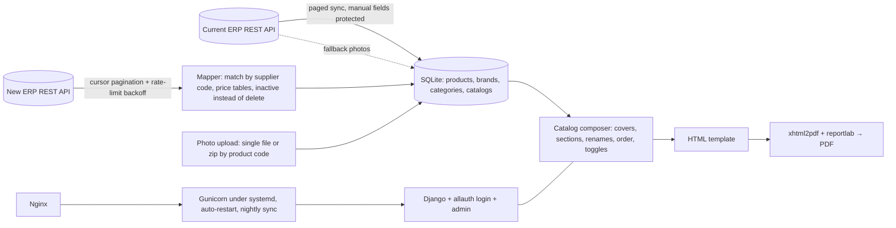

# PDF Catalog Generator: Case Study

> A Django system that syncs a B2B distributor's product base from its ERP and lets the sales team assemble branded PDF catalogs by brand, category, or hand-picked products, plus the recovery, security review, and ERP migration work done on it in late 2026.
> **Source code is private.** This repository documents the project; a live walkthrough is available on request.

**Stack:** Python 3.13, Django 5.2, SQLite, django-allauth, xhtml2pdf and reportlab for PDF rendering, pyHanko and pypdf in the PDF toolchain, Pillow, requests against two ERP REST APIs, Nginx reverse proxy on an Ubuntu VPS, Gunicorn and systemd in the recovery plan.

**Status:** pilot for a B2B distributor in Brazil. The catalog system was built in July 2025 and ran on the client's VPS. In October 2026 I assessed it, diagnosed why it had gone offline, wrote the security review and a recovery and upgrade plan, and prepared the migration package from the current ERP to the new one; the relaunch and the ERP switch wait for the client's go-ahead.

## Problem → Solution

**Problem.** The distributor sells thousands of items across many brands and needs catalogs for different customers and campaigns: one brand only, one category, a promotional selection with its own price table. Doing this in a desktop publishing tool meant re-typing prices that already live in the ERP. The system that solved this went offline in January 2026 and nobody noticed how or why, and the company is now moving to a different ERP whose API behaves very differently.

**Solution.** A web app where products, categories, and prices are synced from the ERP into a local database, the user composes a catalog (cover, back cover, logo, index, which brands and categories, renamed sections, product order, show or hide prices and images), and the system renders it to PDF. On top of that, a recovery plan that turns a hand-started development server into a supervised service, a security review with concrete findings, and a migration layer that reads from the new ERP while keeping every catalog and manual edit intact.

## What I built

- **Product base mirrored from the ERP.** A product model with 43 fields (codes, supplier SKU, fiscal codes, prices, promotional price, weights, packaging, stock limits, SEO text), plus brands and a two-level category tree reused by name. A sync routine pulls from the ERP's REST API page by page and never overwrites fields the team edits by hand: brand, promotional price, barcode, notes, image.
- **Catalog composer.** A catalog configuration with 17 settings: cover, back cover, logo, and index images; toggles for images, prices, and names; brand and category selections with per-catalog renamed sections and custom ordering; and hand-picked product lists for "new" and "promotion" sections that are stored by product code so they survive re-syncs.
- **PDF rendering.** The composed catalog is rendered from an HTML template to PDF with xhtml2pdf over reportlab, products grouped by brand and category with the per-catalog names and order applied.
- **Outage diagnosis.** The site had been returning a gateway error since January 2026. Reading the server showed the cause: the app had been started by hand with the framework's development server, with no service manager, no restart policy, and no monitoring, so one dead process took the site down for months. Server logs no longer reached back to the day it died, so the report says what can and cannot be proven.
- **Security review.** A manual read of the application code, confirmed against an automated review, produced four critical findings and a set of medium ones, each with the fix planned for the upgrade phase. Secrets were kept out of the repository from the first commit: the settings file with credentials never left the server, and the client's database and media stay off GitHub.
- **Recovery and upgrade plan.** Snapshot first; Gunicorn under systemd with automatic restart; debug off, allowed hosts and static files checked; uptime monitoring with alerts to the client's own mailbox; nightly sync instead of a button that can time out; pinned dependencies; framework, library, and OS upgrades with the PDF toolchain flagged as the sensitive spot to regression test.
- **ERP migration package.** A client for the new ERP's API with the two behaviors its certification demands: cursor pagination driven by a "limited records" header and a last-modified timestamp, and rate-limit handling that waits exactly the time the API returns instead of a fixed delay. A mapper matches existing products by supplier code so catalogs keep working, flags ambiguous codes for a human, marks items removed upstream as inactive instead of deleting them, and models price tables and per-product prices so a catalog can be promotional with its own price table, "from/to" prices, validity date, and a warning for products missing from that table.
- **Photo strategy.** The new ERP's API exposes image hashes but no files, so photos come first from uploads in the system (one by one or a zip named by product code) and fall back automatically to the old ERP for products still without a picture.

## Architecture

## Technical challenges

- **Diagnosing without logs.** The system journal only covered the last few days, months after the outage. The diagnosis rests on what could be shown (last write to the process output file, the proxy error, the way the process had been launched) and states plainly that the trigger in January cannot be proven.
- **Keeping catalogs valid across two ERPs.** Catalogs reference products by code and categories by id. The migration keeps every existing product code untouched, matches new-ERP items to old ones by supplier code, and generates a prefixed code only on collision, so no saved catalog breaks.
- **An API with no brands, no promotional prices, and no images.** The new ERP has no brand field, no fixed promotional price, and returns only image hashes. Brands stay as manually maintained data, promotions move to price tables selected per catalog, and photos come from uploads with the old ERP as fallback.
- **Certification rules that fail silently.** The new ERP's certification rejects integrations that do not paginate by cursor or do not honor the rate-limit wait time. Both are implemented as the only path through the client, and the package ships a sandbox test that produces the evidence file the certification asks for.
- **Doing the work before the deal closes without touching production.** All of this was built locally from a copy of the server code, with hard rules: nothing on the VPS changes without explicit approval, a snapshot precedes any change, and tokens never enter code, git, logs, or chat.

## Scale

- 3,225 lines of Python in the application (including a 1,005-line legacy copy of the views flagged for removal)
- 7 Django models; a product model with 43 fields and a catalog model with 17 settings
- 16 URL routes and 46 HTML templates
- 32 pinned dependencies in the requirements file generated from the server's environment
- 4 critical security findings documented with fixes planned
- 0 automated tests in the inherited application; the migration package was written with its own unit tests against simulated API responses

## My role

Technical lead for the engagement: read and documented the inherited system, diagnosed the outage from the server, wrote the security review, the scope and the recovery and upgrade plan, designed the data mapping between the two ERPs, built the new ERP client, sync, price-table model, and photo fallback as a package ready to be wired in, and prepared the sandbox test for the ERP's certification.

---
Built by **Victor Sestrem** · [LinkedIn](https://www.linkedin.com/in/victor-sestrem/) · victor-sestrem@hotmail.com
